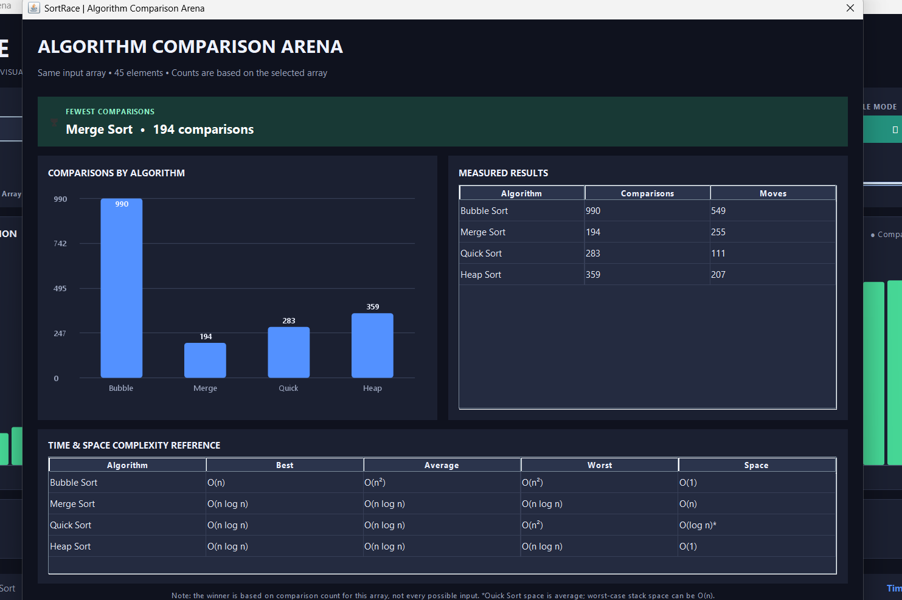
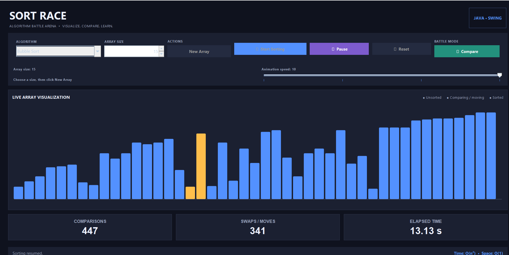

# SortRace — Sorting Algorithm Visualizer

SortRace is a Java Swing desktop application that visualizes and compares popular sorting algorithms through animated bar charts.

## Features
- Visualize sorting algorithms using animated bars.
- Compare multiple sorting algorithms.
- Track algorithm performance metrics.
- Explore time and space complexity.

## Algorithms
- Bubble Sort
- Merge Sort
- Quick Sort
- Heap Sort

## Tech Stack
- Java
- Java Swing
- Data Structures and Algorithms

## How to Run

Make sure Java JDK is installed.

```bash
javac -d out src/Main.java
java -cp out Main
```

## Purpose
Built to understand sorting algorithms, compare their behavior, and visualize how they organize data.

## Author
Parvesh Bandhu

## Screenshots

### Main Dashboard


### Algorithm Comparison Arena


### Live Sorting Animation
